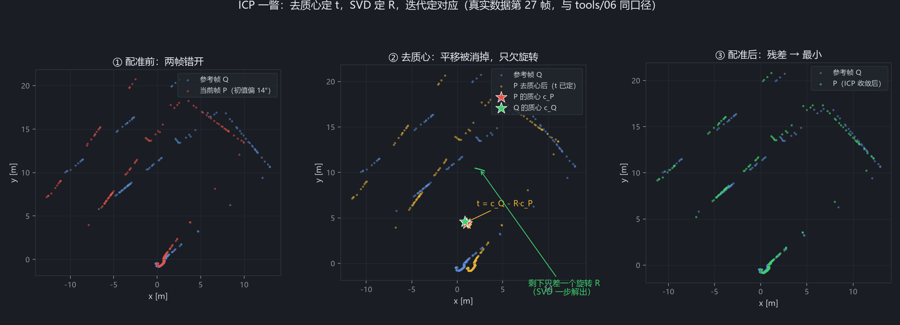

# ICP 理论推导：从最小二乘到 SVD 闭式解

这篇笔记把 W2 实验里那 12 行 ICP 代码（`tools/06_icp_minimal.py` 的 `kabsch` + `icp`）背后的数学
一步不跳地推一遍。读者预设：会一点线性代数（矩阵乘法、特征值）和一点概率论（均值、方差），
但第一次见 SLAM。

符号约定：点都是 2 维列向量（我们的数据是水平激光，工作在平面上；推导对 3 维完全一样，
只是矩阵从 2×2 变 3×3）。上标 T 表示转置，tr(·) 表示矩阵的迹，det 表示行列式。

---

## 1. 问题形式化：把「配准」写成一个优化问题

机器人每隔 1/37 秒扫到一帧点云。第 *k* 帧在**它自己的激光坐标系**下记为点集
P = {p₁, …, p_N}，上一帧 Q = {q₁, …, q_N}。因为机器人挪了一点，同一个墙角在两帧里的
坐标不一样。假设我们**已经知道**谁是谁：pᵢ 和 qᵢ 是同一个物理点（先这么假设，第 3 节
再拆掉它）。

那么存在一个旋转矩阵 R 和一个平移向量 t，使得对每个 i 都有

$$q_i \approx R\,p_i + t$$

「≈」是因为有测距噪声。配准就是求让误差总和最小的那个 (R, t)：

$$\min_{R,\,t}\; E(R, t) = \sum_{i=1}^{N} \left\| q_i - (R\,p_i + t) \right\|^2,
\qquad \text{s.t. } R^T R = I,\; \det R = +1$$

这就是**最小二乘目标函数**。每一项 $\|q_i - R p_i - t\|^2$ 是第 i 对点的残差平方，
几何意义就是「qᵢ 离变换后的 pᵢ 有多远」的平方。

约束条件必须盯紧：R 不是随便一个矩阵，它得是**旋转矩阵**——正交（R^T R = I，列向量
两两正交且长度为 1，旋转不改变距离）且行列式为 +1（排除镜像反射，刚体运动不能把自己
翻成镜像）。正是这个约束让问题不能直接「求导令零」了事，后面第 2.3 节会看到它怎么起作用。

> 概率视角（一句话）：如果测距噪声是零均值各向同性的高斯噪声，那么最大似然估计恰好
> 就是最小二乘——平方误差不是拍脑袋，是「高斯假设下最合理」的选择。

---

## 2. 闭式解推导：三步消元，一次 SVD

目标：**精确、不迭代地**解出第 1 节的优化问题（对应已知的前提）。这一步叫 Kabsch 算法
（Kabsch, 1976），代码里就是那 8 行 `kabsch`。

### 2.1 第一步：去质心，把 t 消掉

定义两个点集的质心：

$$c_P = \frac{1}{N}\sum_i p_i, \qquad c_Q = \frac{1}{N}\sum_i q_i$$

技巧：把每个点改写成「质心 + 相对质心的偏移」。令

$$\tilde{p}_i = p_i - c_P, \qquad \tilde{q}_i = q_i - c_Q$$

代回目标函数：

$$
\begin{aligned}
E(R,t) &= \sum_i \left\| q_i - R p_i - t \right\|^2 \\
&= \sum_i \left\| (\tilde{q}_i + c_Q) - R(\tilde{p}_i + c_P) - t \right\|^2 \\
&= \sum_i \left\| \big(\tilde{q}_i - R\,\tilde{p}_i\big) + \big(c_Q - R c_P - t\big) \right\|^2
\end{aligned}
$$

这是「向量 a + 向量 b」的模方和，其中 $a_i = \tilde q_i - R\tilde p_i$，
$b = c_Q - R c_P - t$（注意 b 不带下标，对所有 i 是同一个向量）。展开：

$$\|a_i + b\|^2 = \|a_i\|^2 + \|b\|^2 + 2\, a_i^T b$$

对 i 求和时，交叉项是

$$2 \sum_i a_i^T b = 2 \left(\sum_i a_i\right)^{\!T} b$$

而

$$\sum_i a_i = \sum_i \tilde q_i - R \sum_i \tilde p_i = 0 - R \cdot 0 = 0$$

——因为去质心后的点集「绕质心对称」，
$\sum_i \tilde p_i = \sum_i (p_i - c_P) = \sum_i p_i - N c_P = 0$（这正是质心的定义），
q 那边同理。**交叉项整个消失了。**

于是目标函数干净地分裂成两块：

$$E(R,t) = \underbrace{\sum_i \left\| \tilde q_i - R\,\tilde p_i \right\|^2}_{\text{只含 } R}
\;+\; \underbrace{N \left\| c_Q - R c_P - t \right\|^2}_{\text{只含 } t \text{（N 个相同的 } \|b\|^2\text{）}}$$

第二项是模方，最小能取到 0，只要令

$$\boxed{\;t = c_Q - R\,c_P\;}$$

就达到。**物理意义**：最优平移就是把 P 的质心（旋转之后）叠到 Q 的质心上。
平移问题就此关闭——不管 R 是什么，t 的最优值都由这个公式给出。剩下的事只有一件：
求 R 使第一项最小。

### 2.2 第二步：把「最小化误差」变成「最大化迹」

对去质心后的点展开第一项：

$$
\sum_i \left\| \tilde q_i - R\,\tilde p_i \right\|^2
= \sum_i \left( \|\tilde q_i\|^2 - 2\,\tilde q_i^T R\,\tilde p_i + \|R\,\tilde p_i\|^2 \right)
$$

三项逐个看：

1. $\sum_i \|\tilde q_i\|^2$：不含 R，是常数；
2. 中间项：含 R，是我们关心的；
3. $\|R\,\tilde p_i\|^2 = (R\tilde p_i)^T(R\tilde p_i) = \tilde p_i^T R^T R\,\tilde p_i
   = \tilde p_i^T \tilde p_i = \|\tilde p_i\|^2$——**这里用上了正交约束 R^T R = I**。
   旋转不改变长度，所以这一项也不含 R 的实际自由度，同样是常数。

两个常数项扔掉不影响求最小，问题等价于：

$$\max_R \; \sum_i \tilde q_i^T R\,\tilde p_i$$

现在把求和写成一个矩阵，好让 SVD 登场。定义**协方差矩阵**（也叫交叉相关矩阵）

$$H = \sum_i \tilde p_i\, \tilde q_i^T \qquad (2\times 2)$$

注意外积的顺序：$\tilde p_i$ 在前。接下来需要一个恒等式把 $\sum_i \tilde q_i^T R\,\tilde p_i$
和 H 缝起来。

**用到的恒等式（逐个列出）：**

- (恒等式 1) 标量等于它自己的迹：标量 x 可以看成 1×1 矩阵，tr([x]) = x。
- (恒等式 2) 迹的循环不变性：对任意尺寸相容的矩阵，
  tr(ABC) = tr(BCA) = tr(CAB)。（证明：直接按定义展开求和，
  $\sum_{i,j,k} A_{ij}B_{jk}C_{ki}$，三个写法是同一些乘积项的不同求和顺序。）

于是：

$$
\tilde q_i^T R\,\tilde p_i
\;\overset{(1)}{=}\; \operatorname{tr}\!\left(\tilde q_i^T R\,\tilde p_i\right)
\;\overset{(2)}{=}\; \operatorname{tr}\!\left(R\,\tilde p_i\,\tilde q_i^T\right)
$$

对 i 求和（迹是线性运算，求和可以进出）：

$$
\sum_i \operatorname{tr}\!\left(R\,\tilde p_i \tilde q_i^T\right)
= \operatorname{tr}\!\left( R \sum_i \tilde p_i \tilde q_i^T \right)
= \operatorname{tr}(R H)
$$

大功告成。**旋转问题等价于：在所有旋转矩阵里，找一个使 tr(R·H) 最大的。**

直觉：H 编码了「两组点往哪些方向一起散开」。tr(RH) 最大就是让 R 把 P 的散布方向
对齐到 Q 的散布方向。

### 2.3 第三步：SVD 解出 R，以及 det = −1 的坑

对 H 做奇异值分解：

$$H = U\,\Sigma\,V^T$$

其中 U、V 是正交矩阵，Σ = diag(σ₁, σ₂)，σ₁ ≥ σ₂ ≥ 0 是奇异值。（代码里
`U, _, Vt = np.linalg.svd(H)` 给出的就是 H = U Σ Vt。）

再需要一个恒等式：

- (恒等式 3) 正交矩阵的每个元素都不超过 1。因为列向量长度为 1，所以每个分量的
  绝对值 ≤ 1。

代进去，并用恒等式 2 再转一次：

$$
\operatorname{tr}(R H) = \operatorname{tr}(R U \Sigma V^T) = \operatorname{tr}(\Sigma\, V^T R U)
$$

记 $M = V^T R U$。V、R、U 都正交，正交矩阵的乘积仍正交（(AB)^T(AB) = B^T A^T A B = I），
所以 M 也是正交矩阵。而

$$
\operatorname{tr}(\Sigma M) = \sigma_1 M_{11} + \sigma_2 M_{22}
$$

由恒等式 3，$M_{11} \le 1$，$M_{22} \le 1$，又 σ 非负，所以

$$\operatorname{tr}(\Sigma M) \le \sigma_1 + \sigma_2$$

等号在 M = I（单位阵）时取到。回代 M = V^T R U = I，解得

$$\boxed{\;R = V\,U^T\;}$$

（写成 numpy 就是 `Vt.T @ U.T`。）

**但是——还差最后一步，也是最常被教科书一笔带过的一步。**

上面只保证了 M 正交、对角元尽量大；M = I 给出的 tr 上界确实最大。问题在于：
我们搜的空间不是「所有正交矩阵」，而是「**行列式为 +1** 的旋转矩阵」。
V 和 U 各自都是正交的，det 可能是 ±1。如果

$$\det(V U^T) = \det V \cdot \det U = -1$$

那 R = VU^T 是个**反射**（镜像），不是合法旋转——它数学上确实最大化了 tr(RH)，
但它把点云翻成了镜像，物理上不存在这种刚体运动。直接用它，ICP 会输出一个
「看起来很配、其实左右颠倒」的解。

怎么办？回到上面的上界推导。现在我们被禁止取 M = I（那给出 det = −1）。
在 det R = +1 的约束下，M = V^T R U 的行列式也跟着被约束：det M = det V · det R · det U
= (−1)·(+1) = −1，即 M 也必须是反射。对角元都取 +1 不可能了（那就是 I，det = +1）。
退而求其次的最优是：让**较小奇异值**对应的那个对角元翻转为 −1，即取

$$M = \operatorname{diag}(1, -1)$$

此时 tr(ΣM) = σ₁ − σ₂。为什么翻 σ₂ 不翻 σ₁？因为 σ₁ ≥ σ₂，翻转 σ₁ 得到
−σ₁ + σ₂ ≤ σ₁ − σ₂，损失更大。牺牲小头保大头。

实现上不用真的去构造 M，等价做法是把修正吸收进 V（或 U）的最后一列：

$$R = V \begin{pmatrix} 1 & 0 \\ 0 & \det(V U^T) \end{pmatrix} U^T$$

当 det = +1 时这就是 VU^T，无事发生；当 det = −1 时它把 V 的最后一列取反，
把反射「掰」回旋转。对照 06 的代码，一字不差：

```python
d = np.sign(np.linalg.det(Vt.T @ U.T))
R = Vt.T @ np.diag([1.0, d]) @ U.T
```

什么时候会踩到这个坑？实践中**点云近乎共线/共面退化**时（比如一面墙上的一排点），
H 接近奇异，SVD 就可能给出反射解。06 用的是真实博物馆点云、几何丰富，正常；
但这两行代码必须一直在，否则某些数据上会静默地错。

---

## 3. 为什么 ICP 是迭代的：对应关系是鸡生蛋问题

第 2 节整个推导建立在「pᵢ 对应 qᵢ 已知」上。现实中两帧激光的点**根本不是同一批物理点**：
机器人动了几厘米，第 27 帧打中墙的这个位置，第 28 帧打中的是旁边一点。没有人知道对应关系。

ICP（Iterative Closest Point，Besl & McKay 1992）的回答是：**不知道就猜，猜完再改**——
交替优化：

1. **定对应**：拿当前估计的 (R, t) 把 P 变换过去，每个点去 Q 里找**最近邻**当对应
   （代码里 `cKDTree(Q).query(Pw)`，距离超过 1.0 m 门限的丢弃）；
2. **定变换**：把这批对应当作真，用第 2 节的 SVD 闭式解求最优 (R, t)，累乘更新；
3. 回到 1，直到残差不再下降。

每迭代一轮，位姿更准一点，最近邻找出的对应就更像真对应一点，下一轮解又更准一点。
这就是**交替优化**（两个耦合的未知数：对应、变换，固定一个解另一个）。

代价是什么？**最近邻是局部贪心**：它只能找到「当前位姿附近」的对应。如果初值离真值太远，
最近邻找到的就是错误配对，SVD 会忠实地把这堆错误配对配得最齐——收敛到一个
**局部极小**，而且残差照样可以很小。误差曲面不是一个碗，是一片丘陵；交替优化只会往
 downhill 走，你落在哪个盆地，取决于你从哪起跳。

这不是理论恐吓，本仓库有实测表格（`docs/ICP误差-初值实验.md`，06 脚本在真实第 27 帧、
400 点、σ=1 cm 噪声、合成真值 6.0°/26.9 cm 上扫初值）：

| 初值偏差 | 收敛后平移误差 | 收敛后角度误差 | 末轮残差 |
|---|---|---|---|
| 0° ~ 22° | 0.27 cm | 0.011° | 0.000125 |
| **24°（临界点）** | **15.76 cm** | **23.689°** | 2.582449 |
| 26° ~ 30° | 15.76 cm | 23.689° | 2.582449 |

误差不是渐变而是**跳变**：22° 还好好的（毫米级），24° 直接掉进另一个盆地。
临界初值偏差约 **24°**。这个数不是普适常数——它依赖场景几何、点数、max_iter
（22° 那次挣扎了 51 次迭代才爬回正确盆地）——但「存在临界值、跨过去就跳变」是
所有 ICP 的共性。所以工程上 ICP 从不敢零初值裸奔，要么用里程计/IMU 预测，要么
用恒速模型（W3 的 10 号脚本就是后者）。

---

## 4. 残差为什么不能当裁判：可观测性与信息矩阵

既然会收敛到错误解，「看残差报不报警」总行吧？06 的表格里残差确实从 0.00013 涨到
2.58（两万倍），这次能报警。但这是**场景赏脸**。

想象一条笔直的长走廊（或者两面平行墙）：机器人**沿着走廊方向**滑动时，激光点始终
贴在那两面直墙上。你把整帧点云沿墙平移半米再配——点对点最近邻找到的对应换了，
但每个点离它「配到的点」仍然很近，残差几乎不变。**沿墙方向的位移是不可观测的**：
数据里根本没有约束这个方向的信息。错配之后残差依然漂亮，裁判瞎了。

把这件事说得稍微正式一点（点到为止，W4 再展开）：把残差对位姿参数
x = (t_x, t_y, θ) 求导得到雅可比 J，那么

$$H_{\text{info}} = J^T J$$

叫做**信息矩阵**（在高斯噪声下它就是 Fisher 信息矩阵，协方差的逆）。它的特征值
告诉你每个方向上有多少约束：

- 特征值大 → 这个方向的误差会被残差强烈惩罚，估计可信；
- **特征值 ≈ 0 → 这个方向没有约束**：沿着它移动，残差几乎不动。长走廊里，
  沿墙方向对应的特征值就塌缩到接近零。

所以「残差小」只证明「在可观测量到的方向上配得好」；不可观测方向上的误差是
免费的、沉默的。W4 的后端优化（位姿图）会真的把信息矩阵搬出来当权重用——边与边
之间谁说话算数，就由各自的 J^T J 决定，到那时你会感谢现在埋下的这个直觉。

## 5. 与真实数据的连接：本仓库的三组数字

上面每一条理论断言，本仓库都有对应的实测数字，全部可以复读：

1. **「闭式解很快」**：`tools/10_odometry.py` 把同一套 Kabsch 跑了 400 帧 × 平均
   8.3 次迭代（恒速初值链），全程 2.1 秒——每帧 SVD 只是 2×2 矩阵的分解。
2. **「残差不能当裁判」实测版**：10 号脚本用**恒速初值**和**零初值**各跑一条
   400 帧链。两条链每帧 RMSE 中位数一模一样（6.02 cm）——按残差裁判，它们同样
   健康；但 400 帧累完，两条轨迹最大偏差 **0.628 m**（第 239 帧），末端差 0.415 m。
   初值不改变「这一帧看起来配没配上」，它改变的是「配到了哪个解上」，而单帧
   零点几度、几毫米的分歧，累乘 399 次就是半米。（详见 `docs/前端里程计.md` §2。）
3. **「ICP 的结果可以当传感器用」**：`tools/09_time_sync.py` 把 ICP 逐帧解出的
   yaw 角速度曲线与 250 Hz IMU 积分曲线做互相关，零滞后相关系数 **r = +0.957**，
   残余时间偏差约 +3 ms——两套完全独立的硬件（激光几何 vs 惯性测量）给出几乎
   相同的旋转估计，说明 ICP 解出的运动是物理真实，不是算法幻觉。
   （详见 `docs/标定与时间同步.md`。）



*图：真实第 27 帧数据上的三步示意（与 06 同口径）。① 初值偏差下两帧错开；
② 去质心后平移被消掉（t = c_Q − R·c_P），只剩一个旋转待解；③ ICP 收敛后。*

---

## 6. 继续读什么

- **工程实现**：`code/kiss-icp/`（KISS-ICP，"Keep It Simple and Stupid"）。
  它的配准内核和我们手写的同源（最近邻 + 最小二乘），差别在三处：
  **体素化**降采样与建图（每立方米体素只保留代表点，速度与内存可控）、
  **自适应对应阈值**（门限随运动不确定性动态调整，而不是我们写死的 1.0 m）、
  以及点到线的误差度量。读完本篇再看它的源码，会发现没有一处是魔法。
- **理论纵深**：《Probabilistic Robotics》（Thrun, Burgard, Fox）第 6 章
  （测距传感器模型）与第 13 章（图优化/SLAM 后端）——本篇第 4 节点到的
  信息矩阵，在那里会展开成完整的图优化理论。
- **同仓库衔接**：单帧实验看 `docs/ICP误差-初值实验.md`（W2），
  400 帧里程计看 `docs/前端里程计.md`（W3），下一篇 W4 后端优化会把
  信息矩阵 J^T J 真正用起来。
