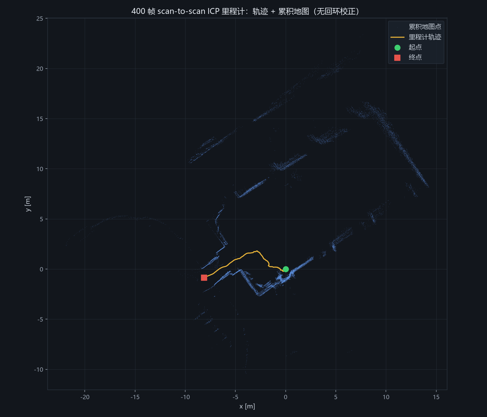
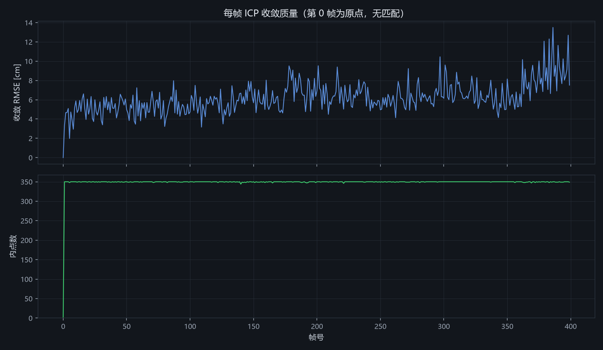

# W3 · 手写前端里程计：把 400 帧激光扫成一条轨迹

代码：`tools/10_odometry.py`（运行约 6 秒）
数据：`datasets/processed/cartographer_paper_deutsches_museum_scans.npz`（400 帧 × 1079 束，实测采集时长 10.73 s，约 37 Hz）

## 1. 里程计在干什么

一句话：**把每一帧贴到上一帧上，然后把相对位姿一格格累乘起来。**

第 1 帧和第 2 帧扫的是同一个房间，只是机器人挪动了几厘米。如果能求出「第 2 帧相对第 1 帧动了多少」（一个 2D 刚体变换：平移 + 旋转），把它乘到累计位姿上，就知道机器人现在在哪儿了。重复 399 次，就得到整条轨迹；把每帧扫描点按当时位姿搬到全局坐标系再摞起来，就是一张地图。

求「相对运动」用的就是 W2 写过的点对点 ICP，一行没改：

1. 当前帧每个点，在上一帧里找最近邻（cKDTree）；
2. 距离超过 1.0 m 的对应扔掉（对应门限，防错误配对）；
3. Kabsch/SVD 闭式解求最优刚体变换，累乘，重复直到残差收敛。

为了快，ICP 只用每帧均匀抽出的 350 个点（原始 1079）。400 帧 × 平均 8.3 次迭代，整条链 **2.1 秒** 跑完。

这就是「前端里程计」的全部：没有回环、没有全局优化，**误差只能累计，没法回头修正**。它快、简单、局部很准——也正因为简单，它最能暴露问题，这就是本周要看的。

## 2. 对照实验：恒速初值 vs 零初值

ICP 是局部收敛算法，初值离真值太远会收敛到错误解（W2 的 06 实验：初值偏差超过约 22° 就跳变到错误解）。里程计里每帧都要给初值，两种选法：

- **零初值**：赌「这一帧没动」（初值 = 单位阵）；
- **恒速初值**：赌「这一帧和上一帧动得一样」（初值 = 上一帧求出的相对运动）。

37 Hz 采样下相邻帧真实运动只有 ~2.7 cm / 帧，所以恒速预测几乎是白送的好初值。同一脚本两条链各跑一遍，数字对比：

| 指标 | 恒速初值 | 零初值 |
|---|---|---|
| 平均迭代次数 | **8.3 次/帧** | 10.2 次/帧（+23%） |
| 迭代次数 p95 | 14 | 17 |
| 全程耗时 | 2.1 s | 2.6 s |
| RMSE 中位数 | 6.02 cm | 6.02 cm |
| 最终位姿 | (−8.11, −0.85, 32.2°) | (−8.40, −1.16, 29.1°) |
| 路径长度 | 10.89 m | 11.01 m |

两条轨迹的**最大偏差 0.628 m（第 239 帧），末端偏差 0.415 m**。

这里有个值得停下来看的细节：**两条链的 RMSE 中位数一模一样（6.02 cm），残差都很漂亮，但 400 帧之后它们差了半米多。** 这正是 06 实验里「收敛到不同解时残差可能同样好看」在真实数据上的重演——每帧差零点几度、几毫米，肉眼和残差都察觉不到，累乘 399 次就是半米。初值不改变「这一帧看起来配没配上」，它改变的是「配到了哪个解上」。

> 为什么恒速初值更稳（代码注释里也有）：ICP 的收敛域是以真值为中心的一个小盆地。零初值等于每帧都站在盆地边缘起跳；恒速初值利用「机器人运动有惯性」这个事实，把起点直接放到盆地中心附近。帧率越高、运动越平滑，这个预测越准。它不花一分钱（只是缓存上一个 T_rel），却同时买到更少的迭代和更小的跑飞概率。

## 3. 400 帧跑完的轨迹和地图



主链（恒速初值）结果：

- 最终位姿 **x = −8.11 m, y = −0.85 m, θ = 32.2°**；
- 路径长度 **10.9 m**（10.73 s 采集，平均速度约 1.0 m/s，与推车采集的常识吻合）；
- 每帧步长均值 2.7 cm、最大 0.11 m——没有任何一帧发生「跳变」；
- 累积地图共 **32,400 点**（每帧增量 81 点）。



质量曲线：RMSE 中位 6.0 cm、最大 13.5 cm，全程没有一帧超过 15 cm；内点数中位 350/350（即 1.0 m 门限内几乎全员配对成功），最低也有 344。从这两个指标看，这条链**每一帧都收敛得很好**。

## 4. 诚实讨论：没有真值，怎么知道漂没漂？

上面所有数字——RMSE、内点数、步长平滑——**全都是「每帧自己跟自己比」的局部指标**。它们能证明「每帧配上了」，证明不了「400 帧累完没漂」。第 2 节已经演示过：残差同样漂亮的两条链，末端差半米。而我们手里没有这条轨迹的真值（ground truth），那怎么判断漂没漂？

没有真值时的三板斧：

1. **看地图重影（鬼影）**。同一面墙被不同时刻的帧各画了一次，如果里程计漂了，墙上会出现两条平行的线。所以「墙是不是一条细线」是最直观的漂移计。本数据上做了一个量化代理：把累积地图里每帧的全局点与其余帧的点云做最近邻，**跨帧最近邻距离中位 0.7 cm、90 分位 2.9 cm**——墙线只有厘米级厚，这段 10.9 m 的轨迹上没有可见重影。
2. **看走廊增厚**。长走廊是 scan-to-scan 的老大难：沿走廊方向的几何约束很弱（点对点 ICP 在走廊里容易「滑动」），表现为地图里的走廊越画越宽、或者本该直的墙变弯。本段数据走廊不长，暂未观察到。
3. **回环自查**。如果轨迹走回起点附近，直接量「起点和终点在地图上该重合却没重合」的缝隙。本段 400 帧是一次性前进、没有回环，所以这招用不上——这也是「无回环校正」写在导出元信息里的原因：现在的地图完全靠前端的局部正确性撑着。

结论要克制：**这段 10.9 m 的轨迹，局部指标和地图一致性都健康；但这是 10 秒数据，距离一长、或者遇到长走廊/空旷大厅，scan-to-scan 迟早会漂——那正是后续要加回环检测（W5+）的理由。**

## 5. 与 06 单帧实验的联系

06（`tools/06_icp_minimal.py`）用合成真值证明：**初值偏差超过约 22°，ICP 会跳到错误解，而且残差可能照样漂亮**。当时用的是一帧人造数据；本周这个结论在 400 帧真实数据上兑现了：

- 零初值和恒速初值每帧 RMSE 中位数完全相同（6.02 cm）——「残差不能当裁判」从合成实验变成了实测现象；
- 两条链的轨迹最大差 0.628 m——「初值决定收敛到哪个解」从单帧的跳变曲线，变成了里程计里的慢性漂移；
- 恒速初值平均少迭代约 2 次/帧——06 的「迭代次数是挣扎信号」在工程上直接兑现为 23% 的算力节省。

06 回答「初值差会怎样」，本篇回答「既然初值这么要紧，里程计里从哪免费拿到好初值」：**用上一帧的运动预测下一帧**。

## 6. 实操清单

复现/把玩：

```powershell
# 一键跑：里程计主链 + 零初值对照 + 导出回放 JSON + 两张图（约 6 s）
D:/slam/env/Scripts/python.exe D:/slam/tools/10_odometry.py
```

产出物：

| 文件 | 内容 |
|---|---|
| `docs/assets/data/slam_replay.json` | 400 帧回放数据（契约 v2 §4）：每帧全局位姿/RMSE/内点数/已变换到全局系的扫描点（≤140 点）+ 累积地图（每帧增量 ≤100 点），1.38 MB |
| `docs/figs/odom_map.png` | 轨迹 + 累积地图（深色 rviz 风格） |
| `docs/figs/odom_quality.png` | 每帧 RMSE 与内点数曲线 |

可调参数（脚本顶部常量）：`N_ICP`（ICP 点数，350）、`GATE`（对应门限，1.0 m）、`MAX_ITER`（60）、`SCAN_OUT`/`MAP_INC`（导出降采样）。

值得自己动手试的：

1. 把 `use_motion_model=False` 那条链的地图也画出来，和主链对比，看半米偏差长在地图哪个位置；
2. 把 `GATE` 从 1.0 m 收到 0.3 m，看 RMSE 和轨迹怎么变（门限收紧 = 更挑剔的对应）；
3. 把 `N_ICP` 降到 100，看速度提升多少、精度损失多少；
4. 进阶思考：scan-to-scan 只跟「上一帧」配，如果把参考换成「最近 5 帧的局部地图」，累计误差会怎么变？（这就是 scan-to-map 的雏形。）
