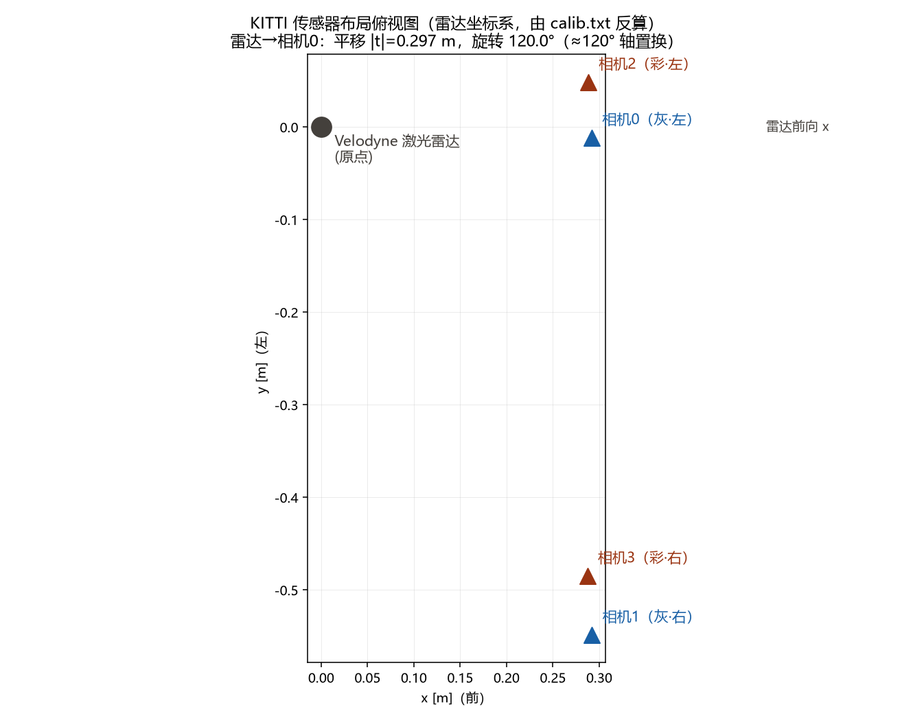
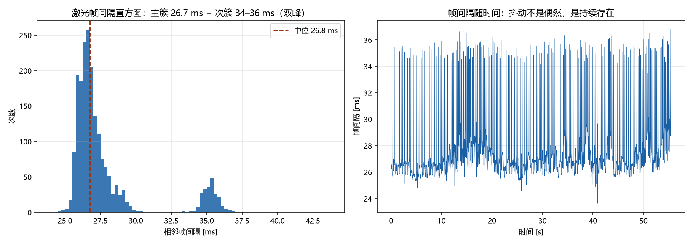
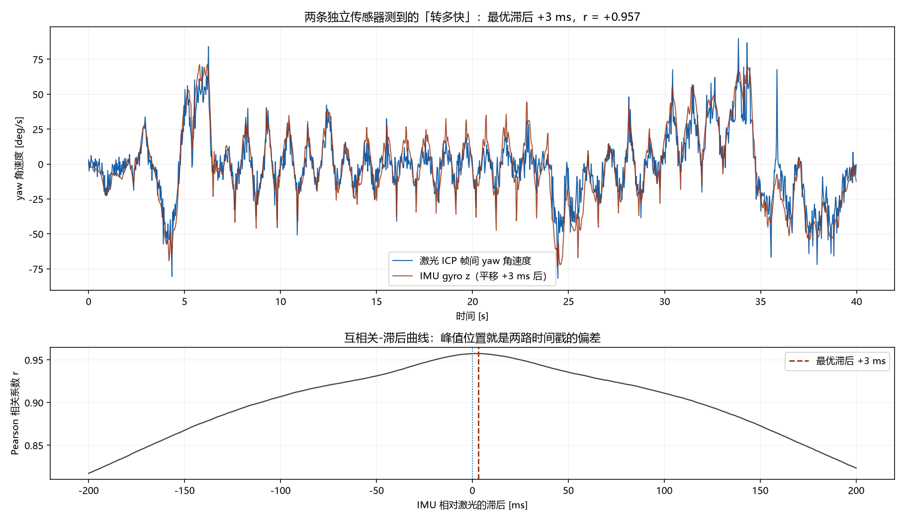

# W2 标定与时间同步 —— 实验 + 学习笔记

> 数据来源：
> - 标定：`datasets/kitti_odometry/dataset/sequences/00/calib.txt`（用 `tools/08_kitti_calib.py` 解析）
> - 时间同步：`datasets/cartographer_2d/cartographer_paper_deutsches_museum.bag`（用 `tools/09_time_sync.py`，取前 2000 帧激光 + 同时段 13877 条 IMU，窗口 55.5 s）
>
> 本文所有数字都是这两个脚本跑出来的实测值，不是抄的手册。

---

## 一、标定到底在标什么

一台装了多个传感器的机器人，每个传感器只活在自己的坐标系里。标定回答两个问题：

**1. 内参：这个传感器自己怎么看世界？**

以相机为例：空间里一个 3D 点，落到图像的哪个像素上？这由焦距和主点决定。焦距错了，整张图的"比例尺"就错了。

**2. 外参：传感器之间相对位置/朝向是什么？**

雷达测到"前方 5 m 有堵墙"，相机要能在自己画面里找到这堵墙——前提是你知道雷达到相机的旋转 + 平移（一个 3×4 刚体变换矩阵）。外参错了，两个传感器看到的同一个物体"对不上账"。

对 SLAM 来说，还多一个隐藏维度：**时间**。每个传感器的时间戳准不准、彼此之间差几毫秒？外参管"空间对齐"，时间同步管"时间对齐"——这篇笔记把两件事一起做。

---

## 二、读 KITTI 的标准答案

KITTI 每个序列的 `calib.txt` 就是一份标准答案。我们解析了 00 序列，里面有两个条目家族：

### 2.1 P0–P3：4 个相机的投影矩阵（内参 + 相机间位移）

每个 P 是一个 3×4 矩阵：**像素坐标 = P × 相机系下的 3D 点（齐次）**。
P 的左 3×3 块就是内参矩阵 K。从 P0 读出：

| 内参 | 值 | 含义 |
|---|---|---|
| fx = fy | 718.856 像素 | 焦距（以像素为单位） |
| (cx, cy) | (607.19, 185.22) 像素 | 主点，接近图像中心 |

P0 的最后一列是 0 —— 相机0是参考系原点。其他相机的最后一列不全是 0，
**那一列里藏着它相对相机0的位移**（除以焦距就是米）：

| 双目对 | 基线（实测反算） |
|---|---|
| 相机0 ↔ 相机1（灰度对） | **53.7 cm** |
| 相机2 ↔ 相机3（彩色对） | **53.3 cm** |

双目测距全靠这条基线：同一个点在左右图里的像素差（视差）× 焦距 ÷ 基线 = 深度。
基线错 1 mm，10 m 外的深度就错约 3.5 cm。

> 一个小发现：KITTI odometry 的 calib.txt **没有 `R0_rect`**（那是 raw 数据集做畸变校正用的），
> odometry 序列的图像已经校正过了，脚本按单位阵处理并如实打印了说明。看真实数据时要习惯
> "手册里有的字段不一定都在"。

### 2.2 Tr：雷达到相机的外参

`Tr`（velodyne → camera0）是一个 3×4 矩阵，拆开是：

| 量 | 实测值 |
|---|---|
| 平移 t | (−0.012, −0.054, −0.292) m，|t| = **0.297 m** |
| 旋转角 | **119.96°**（约 120°） |
| 转轴 | (0.577, −0.582, 0.573) ≈ (1,−1,1)/√3 |

约 120° 的旋转不是雷达装歪了——它本质是**坐标轴换序**：雷达系是 x 前 / y 左 / z 上，
相机系是 z 前 / x 右 / y 下，两个约定之间恰好差约 120° 的轴置换。剩下的小残差（0.0x° 量级）
才是真实的安装偏差。平移 0.297 m 说明雷达装在相机旁边/上方约 30 cm 处——这就是"杠杆臂"。

把 4 个相机反算回雷达坐标系（x 前 / y 左 / z 上），布局一目了然：



| 相机 | 在雷达系下的位置 [m] |
|---|---|
| 相机0（灰·左） | (+0.292, −0.011, −0.056) |
| 相机1（灰·右） | (+0.292, −0.549, −0.061) |
| 相机2（彩·左） | (+0.288, +0.049, −0.057) |
| 相机3（彩·右） | (+0.287, −0.485, −0.058) |

4 个相机的光轴方向都是 (+1.000, +0.000, −0.007) —— 全部朝正前方，微微下俯 0.4°。

---

## 三、时间同步为什么和标定同等重要

外参错了，两个传感器"空间上对不齐"；时间戳错了，它们"时间上对不齐"。
后者常被新手忽略，因为时间戳"看起来总是有值的"。用主 bag 实测给你看。

### 3.1 激光帧间隔不是均匀的：双峰分布

标称 40 Hz 的水平激光，实测（前 2000 帧，55.5 s 窗口）：

| 统计量 | 实测值 |
|---|---|
| 帧间隔中位 | 26.76 ms |
| 帧间隔均值 | 27.75 ms |
| 最小 / 最大 | 23.62 / 36.81 ms |
| 标准差 | 2.78 ms |
| 实测帧率（1/中位间隔） | 37.37 Hz |



直方图是**双峰**的：主簇 26–30 ms 占 73.6%，次簇 33–38 ms 占 11.0%。
也就是说约 1/9 的帧"迟到"了一个节拍——不是 bug，是真实采集系统的调度抖动。

**"假设固定 26.7 ms"会累积多少系统性偏差？** 实测均值是 27.75 ms，比 26.7 每帧多 1.046 ms。
如果图省事给第 i 帧赋时间戳 `t = i × 26.7 ms`，那么：

- 在实测的 55.5 s / 1999 帧窗口末尾，累积偏差已经达到 **+2090 ms（约 2.1 秒）**；
- 按每帧 1.046 ms、37.37 帧/秒外推：每秒累积约 39 ms，整段 31.9 分钟的 bag 末尾会偏 **约 75 秒**。

2 秒的时间误差意味着什么？见 4.2。

### 3.2 IMU 比激光快约 7 倍，而且也是"成批到达"的

同一个 bag 里的 IMU（标称 250 Hz）：

| 统计量 | 实测值 |
|---|---|
| 平均速率 | 250 Hz |
| 每个激光周期内的 IMU 样本数 | 均值 **6.94**，最少 **4**，最多 **11** |
| bag 录制时间下的间隔 | 中位 5.91 ms，最大 16.10 ms |

注意"平均 250 Hz 但间隔中位 5.91 ms（≈169 Hz）"这个矛盾：IMU 消息在 bag 里不是等间隔的，
而是**一小批一小批到达**——录制端也有缓冲和调度。结论有两个：

1. 好消息：每个激光周期里至少有 4 个 IMU 样本，做插值/积分绰绰有余；
2. 坏消息是：**bag 时间戳本身有毫秒级的不确定性**，不能完全当真。

### 3.3 挑战实验：两条独立的"转多快"曲线对得上吗？

激光和 IMU 是两块完全独立的硬件。如果它们的时间戳都没问题，那么：

- 用相邻激光帧做 ICP 估计出的帧间 yaw 角速度；
- 用 IMU gyro z 在同一区间积出来的平均角速度；

这两条曲线应该高度重合。实测：1999/1999 对激光帧 ICP 全部成功，
两条角速度序列的范围也吻合（ICP：[−161.3, +156.7] deg/s，IMU：[−131.5, +124.7] deg/s）。

在 ±200 ms 内以 1 ms 步长扫滞后量做互相关：

| 结果 | 值 |
|---|---|
| 零滞后相关系数 r(0) | **+0.957** |
| 最优滞后 | **+3 ms** |
| 最优滞后处相关系数 | **+0.957** |



解读：r = 0.957 说明两个传感器测到的旋转运动高度一致——这个 bag 的激光与 IMU
时间戳对齐得相当好（残余偏差只有约 3 ms，在 ±200 ms 扫描范围内是个尖锐的单峰）。
**这个实验同时就是"时间标定"的做法**：如果两条曲线平移几十毫秒才对齐，
那个滞后量就是你要修的时间偏差。也说明上面 3.2 的"成批到达"主要是录制端的时间戳噪声，
对运动信息的破坏有限。

---

## 四、错了会怎样：两个具体例子

### 4.1 外参错 1° 的代价

假设雷达→本体的外参旋转角有 1° 误差。一堵 10 m 外的墙，转换到本体坐标系时会偏
`10 × tan(1°) = 17.5 cm`。后果链：

1. 相邻两帧扫描里同一堵墙对不齐 → ICP 的对应点一开始就错；
2. 参照 W1 的 ICP 实验（`docs/ICP误差-初值实验.md`）：初值偏差跨过临界值后，
   ICP 收敛到错误解而且迭代次数逼近上限——**外参误差是常驻的"坏初值"，每一帧都在**；
3. 建出来的地图出现"双层墙"，且这种错误不会随时间平均掉，因为它是系统性的。

### 4.2 时间戳错 10 ms 的代价

实测这段数据里最大 yaw 角速度约 161°/s（人背着设备转身）。如果 IMU 和激光的时间戳
相差 10 ms：

- 姿态角误差 = 161°/s × 0.01 s = **1.61°**；
- 用错了 1.61° 的姿态去"摆正"一帧激光，10 m 处的点偏 `10 × tan(1.61°) ≈ 28 cm`。

再对比 3.1：如果你用"固定 26.7 ms"赋时间戳，55 秒后偏差已经是 2.1 秒——
同样的转身速度下相当于 340° 的姿态误差，地图直接画成一团毛线。
**时间同步的误差和测距噪声不同：它不随机，只随时间单调累积，跑得越久地图越烂。**

---

## 五、实操清单（照做可复现本文所有数字）

在 Git Bash 里（或把 `D:/slam/env/Scripts/python.exe` 换成你的 venv 解释器）：

```bash
# 1. 解析 KITTI 标定，生成传感器布局图
D:/slam/env/Scripts/python.exe D:/slam/tools/08_kitti_calib.py
#   看终端打印的矩阵和「外参拆解」；图在 docs/figs/kitti_sensor_layout.png

# 2. 时间同步三个实验（默认处理前 2000 帧，约 1 分钟跑完）
D:/slam/env/Scripts/python.exe D:/slam/tools/09_time_sync.py
#   图在 docs/figs/time_sync_intervals.png 和 docs/figs/time_sync_yawcorr.png

# 想跑更长的窗口（更慢）：
D:/slam/env/Scripts/python.exe D:/slam/tools/09_time_sync.py --max-frames 5000
```

自检要点：

- 08 脚本打印的平移应为 |t| ≈ 0.297 m、旋转角 ≈ 120°；
- 09 实验①的直方图应看到 26.7 ms 主簇 + 34–36 ms 次簇；
- 09 实验③的 r(0) 应 ≈ 0.96、最优滞后 ≈ +3 ms；若你换了 bag 或数据集，
  最优滞后不再是 0 附近，那就是发现了真实的时间偏差——这正是本实验的用途。

### 本周带走的四句话

1. **内参**管传感器自己怎么看世界，**外参**管传感器之间的相对位姿，**时间同步**管它们的对齐时刻——三者缺一个，多传感器融合都是错的。
2. KITTI 的 calib.txt 是标准答案的格式范本：P0–P3（内参+基线）+ Tr（外参）。
3. "帧率 40 Hz"是标称值；实测间隔中位 26.76 ms 且双峰分布，按固定间隔赋时间戳会在半小时尺度上累积出分钟级偏差。
4. 时间对不对，可以用两块独立硬件互相验证：激光 ICP 的 yaw 曲线 vs IMU 积分曲线，互相关一扫就知道（本 bag 残余偏差约 +3 ms，r = 0.957）。
